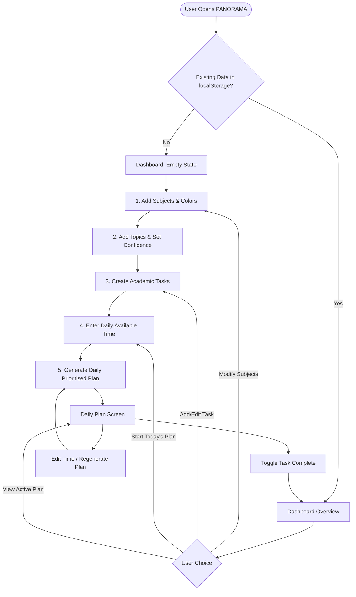
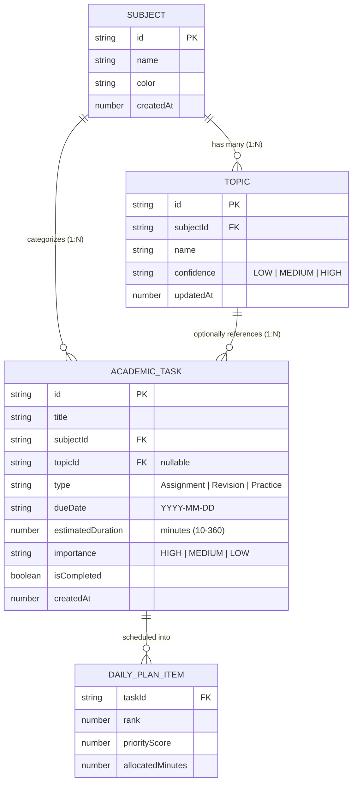

# PANORAMA — Comprehensive Project Analysis & Architecture Specification

> **Project:** PANORAMA (Personalised Study Planning and Prioritisation)  
> **Tagline:** *"From scattered pieces to the bigger picture."*  
> **Target Audience:** First-year university students managing multiple academic subjects, assignments, exams, and fluctuating schedules.  
> **Primary References:** `design.md` (Design System & Visual Spec) and `flow.md` (Application Flow & User Journey).  
> **Status:** Pre-Implementation Architectural Analysis & Roadmap.

---

## 1. What the Project Is

**PANORAMA** is a minimalist, responsive, client-side web application designed to eliminate academic decision paralysis for university students. 

### The Core Problem
First-year university students frequently struggle to balance coursework, projects, revision, and personal commitments across 4–6 demanding subjects. When faced with multiple overlapping deadlines, students often default to studying what feels easiest or most comfortable rather than what is most critical, resulting in last-minute cramming, poor grades, and elevated stress.

### The Solution & Core Value Proposition
PANORAMA provides an objective, deterministic planning engine that translates scattered academic obligations into a realistic, sequenced daily study schedule. Rather than overwhelming students with complex calendars or unconstrained to-do lists, PANORAMA:
1. Deconstructs academic subjects into granular syllabus topics with subjective **confidence ratings** (*Low, Medium, High*).
2. Captures discrete **academic tasks** with deadlines, estimated durations, and importance tiers.
3. Takes the student's **daily available study time** (e.g., 120 minutes) as a hard constraint.
4. Uses a weighted mathematical formula and greedy packing algorithm to generate an actionable, prioritised study queue that fits precisely within their schedule for the day.

### Guiding Aesthetic & Architectural Principles
- **Aesthetic Philosophy:** Minimalist Modern Academic Productivity — Calm, refined, structured, and free of visual clutter. Grounded in a rich slate navy palette (`#0F172A`, `#1E293B`), pure white surfaces (`#FFFFFF`), light canvas grey (`#F8FAFC`), and purposeful royal blue accents (`#2563EB`).
- **Architectural Philosophy:** Zero-dependency, lightweight client-side Single-Page Application (SPA). Built exclusively with vanilla HTML5, CSS3 Custom Properties, and ES6+ JavaScript. All data persists locally in the browser via `localStorage`—no backend servers, external databases, or user accounts are required.

---

## 2. What Needs to Be Built

The final deliverable is a complete, production-ready, fully responsive web application contained in the `Inception Project` workspace, strictly adhering to the design and behavioral contracts established in `design.md` and `flow.md`.

### In-Scope Functional Capabilities (The Three Must-Have Groups)

| Category | Specific Capabilities to Build |
|:---|:---|
| **1. Subjects & Topics Breakdown** | • Create, view, edit, and delete academic subjects with custom color tags.<br>• Add granular topics under each subject.<br>• Assign and update 3-tier topic confidence ratings (*Low, Medium, High*).<br>• Visual confidence badge indicators and interactive segmented radio pills. |
| **2. Academic Task Management** | • Create academic tasks tied to a subject and an optional syllabus topic.<br>• Categorize by Task Type (*Assignment, Revision, Practice*).<br>• Assign due dates (`YYYY-MM-DD`), estimated duration (10–360 minutes), and importance (*High, Medium, Low*).<br>• Client-side input validation and completion status toggling. |
| **3. Prioritisation & Daily Plan** | • Numerical and preset selection of daily available study minutes (60, 90, 120, 180, 240 min).<br>• Deterministic multi-factor priority scoring algorithm.<br>• Greedy time-budget packing engine.<br>• Ranked daily queue cards displaying durations, subject pills, and rationale tags.<br>• Visual time allocation progress meter and overflow/deferred task notifications. |
| **4. Core Navigation & Shell** | • Desktop fixed sidebar (`260px`) with branding and persistent status badge.<br>• Mobile bottom navigation bar (`60px`, 4 touch-friendly tabs).<br>• Top status bar with breadcrumbs and live calendar date.<br>• Vanilla JS single-page view router with smooth fade transitions. |

### Explicitly Excluded (Out of Scope per Documentation)
To preserve the focused MVP definition in `flow.md`:
- ❌ No user authentication, passwords, or multi-tenant user accounts.
- ❌ No cloud backend, REST APIs, or remote databases.
- ❌ No AI chatbots, natural language parsers, or LLM-driven schedule adjustments.
- ❌ No automated ticking countdown timers or Pomodoro alarms.
- ❌ No college LMS/ERP scraping or automated syllabus import.
- ❌ No social features, leaderboards, or file attachments.

---

## 3. Required Website Pages & View Architecture

In accordance with Section 4.2 of `design.md`, PANORAMA operates as a Single-Page Application (SPA) where each view is represented by a `<section class="view-panel" id="view-[name]">` container. Only one view is `.active` at any given time, managed via vanilla JavaScript DOM toggling.

```
+----------------------------------------------------------------------------------------------------+
|                                    APPLICATION VIEW ARCHITECTURE                                   |
+--------------------------+-------------------------------------------------------------------------+
| NAVIGATION SHELL         | VIEW PANELS (Single-Page Switcher)                                      |
|                          |                                                                         |
| • Desktop Sidebar (260px)| 1. #view-dashboard   ──> Overview, capacity card, top 3 priorities, CTA |
| • Mobile Bottom Bar (60px)| 2. #view-subjects    ──> Master-detail subject & topic confidence list |
| • Top Status Bar         | 3. #view-tasks       ──> Task inventory list + "Add Academic Task" form|
|                          | 4. #view-daily-plan  ──> Time budget input, algorithm output, task cards|
+--------------------------+-------------------------------------------------------------------------+
```

### Detailed Screen Specifications

#### 1. Screen 1: Dashboard (`#view-dashboard`)
- **Hero Banner:** Greeting (*"Good morning!"* or context-aware greeting), subtitle (*"Your study plan at a glance"*), and current date.
- **Today's Capacity Card:** Visual summary highlighting available minutes and planned task count (e.g., *"Today: 2 hours available | 4 planned study blocks"*).
- **Priority For Today List:** Renders the top 3 prioritized study items in clean stacked rows with rank numbers (`1.`, `2.`, `3.`), subject pills, action verbs, and topic descriptions.
- **Quick Action Container:** Prominent action buttons:
  - `[ ADD TASK ]` (Primary navy CTA -> routes to Task Form).
  - `[ VIEW SUBJECTS ]` (Secondary outline -> routes to Subjects View).
  - `[ GENERATE DAILY PLAN ]` / `[ VIEW TODAY'S PLAN ]` (Accent blue CTA -> routes to Daily Plan).
- **Contextual Empty States:** Clean state triggers for first-time users guiding them directly to add their first subject.

#### 2. Screen 2: Subjects & Topic Confidence (`#view-subjects`)
- **Master-Detail Two-Column Layout (Desktop) / Vertical Stack (Mobile):**
  - **Left / Master Section (Subjects Panel):**
    - Subject creation card with subject name input and color-picker badge selector.
    - List of subject cards displaying subject name, color indicator, and topic count badge (e.g., *"Mathematics | 4 topics added"*).
    - Active subject selection state triggering child topics on the right.
    - Delete and edit controls per subject.
  - **Right / Detail Section (Topics & Confidence Panel):**
    - Selected subject header.
    - Inline topic creation form: Topic Name input (`"e.g. Functions & Relations"`) + initial confidence level selector + `[ ADD TOPIC ]` button.
    - List of topics belonging to the selected subject.
    - Interactive 3-segment confidence pills on each topic row:
      - `Low` (`#FEF2F2` bg, `#EF4444` border/text)
      - `Medium` (`#FFFBEB` bg, `#F59E0B` border/text)
      - `High` (`#ECFDF5` bg, `#10B981` border/text)
    - Instant in-memory and `localStorage` update upon clicking any confidence tier.
- **Navigation Footer Control:** `[ SAVE SUBJECT DETAILS / CONTINUE TO TASKS ]` to proceed through the onboarding flow.

#### 3. Screen 3: Academic Tasks (`#view-tasks`)
- **Unified Academic Task View (List & Creation Form):**
  - **Task Creation Form (Screen 2 Wireframe):**
    - Centered card container (max-width `640px`).
    - Breadcrumbs: `Task details | New task`.
    - Form fields:
      1. *Task name:* Text input (placeholder: `"e.g. Complete Maths assignment"`).
      2. *Subject:* Select dropdown populated from `panorama_subjects`.
      3. *Associated Topic:* Dependent dropdown populated with topics of the chosen subject (plus *"None / General"* option).
      4. *Task type:* Select dropdown (`Assignment`, `Revision`, `Practice`).
      5. *Due date:* HTML5 date input (`YYYY-MM-DD`).
      6. *Estimated time:* Number input in minutes (bounds: 10 to 360 min).
      7. *Importance:* 3-pill toggle (`High`, `Medium`, `Low`).
    - Action buttons: `[ SAVE TASK ]` (Primary navy) and `[ CANCEL / VIEW TASKS ]` (Secondary).
  - **Active Task List / Inventory:**
    - Filterable by Subject, Task Type, or Completion status.
    - Task cards displaying title, due date badge, duration chip, importance tag, and topic confidence tag.
    - Direct action to mark completed, edit, or delete task.

#### 4. Screen 4: Daily Prioritised Plan (`#view-daily-plan`)
- **Time Budget Control Header:**
  - Input field for daily available minutes.
  - Quick-preset pill buttons: `60m`, `90m`, `120m`, `180m`, `240m`.
  - Primary button: `[ GENERATE PRIORITISED PLAN ]` / `[ REGENERATE PLAN ]`.
- **Plan Summary Header & Capacity Meter:**
  - Metric headline: *"Available time: 120 minutes | Planned: 110 minutes | 3 tasks selected"*.
  - Horizontal visual progress bar indicating time fill ratio (`110m / 120m`) in royal blue with remaining buffer highlighted.
- **Ranked Study Queue Cards:**
  - Chronologically ordered study blocks (`1.`, `2.`, `3.`, ...).
  - Each card features:
    - Rank badge.
    - Task title and action verb.
    - Subject color pill and Topic title.
    - Duration chip (e.g., `45 min`).
    - Rationale tag highlighting why it was prioritized (e.g., `Due Tomorrow`, `Weak Topic (Low Conf)`, `Major Assignment`).
    - Completion checkbox / toggle button.
- **Deferred / Overflow Tasks Section:**
  - Clean secondary list showing tasks with high priority that could not fit into today's available time budget, marked *"Scheduled for Next Session"*.
- **Plan Control Actions:**
  - `[ START FIRST TASK ]` (Focuses on task #1).
  - `[ EDIT AVAILABLE TIME ]` (Reveals time input to adjust schedule).
  - `[ REGENERATE PLAN ]` (Recalculates based on modified tasks or updated topic confidence).

---

## 4. Required Functionality & Mathematical Logic

### 4.1 Prioritisation Engine (Deterministic Scoring)
The core differentiator of PANORAMA is its deterministic, mathematically sound algorithm that avoids black-box heuristics or unpredictable AI behavior.

#### Mathematical Formula
For every uncompleted task $i$, the Priority Score $P_i$ is computed as:

$$P_i = (0.45 \times S_{urgency}) + (0.30 \times S_{importance}) + (0.25 \times S_{confidence})$$

#### Parameter Scoring Matrix

1. **Urgency Score ($S_{urgency}$)**:
   Calculated from calendar day difference $\Delta days = \lceil D_{due} - D_{today} \rceil$:
   - $\Delta days < 0$ (Overdue): **100**
   - $\Delta days = 0$ (Due Today): **95**
   - $\Delta days = 1$ (Due Tomorrow): **85**
   - $\Delta days = 2$ (Due in 2 Days): **70**
   - $3 \le \Delta days \le 4$ (Due in 3–4 Days): **55**
   - $5 \le \Delta days \le 7$ (Due in 1 Week): **40**
   - $\Delta days > 7$ (Due in $>1$ Week): **20**

2. **Importance Score ($S_{importance}$)**:
   - High Importance: **100**
   - Medium Importance: **60**
   - Low Importance: **30**

3. **Topic Confidence Gap Score ($S_{confidence}$)**:
   Inverts student confidence so weaker areas receive higher study urgency:
   - Low Confidence: **100** (Highest knowledge gap; urgent remediation)
   - Medium Confidence: **60** (Moderate familiarity; practice needed)
   - High Confidence: **20** (Solid mastery; maintenance only)
   - *No Topic Linked / General:* **50** (Neutral baseline)

### 4.2 Greedy Time-Budget Packing Algorithm
Once all tasks are scored, PANORAMA schedules tasks within the student's available time limit:
1. Filter out all completed tasks (`isCompleted === true`).
2. Calculate $P_i$ for all remaining candidate tasks.
3. Sort tasks in descending order of $P_i$.
4. Iterate through sorted tasks:
   - If `(accumulatedTime + task.estimatedDuration) <= availableTime`:
     - Append task to `plannedTasks`.
     - `accumulatedTime += task.estimatedDuration`.
   - Else:
     - Mark task as `deferred` (*Scheduled for Next Session*).
5. Compute:
   - `totalAllocatedMinutes = accumulatedTime`
   - `remainingBufferMinutes = availableTime - accumulatedTime`
6. Persist the generated plan object to `localStorage.setItem('panorama_daily_plan', ...)` and render.

---

## 5. Detailed User Workflows



### Workflow 1: New Student First-Run Onboarding
1. **Landing:** Student opens application; dashboard recognizes that `panorama_subjects` is empty.
2. **Setup Prompt:** Displays an encouraging empty-state banner: *"Welcome to PANORAMA! Start by adding your current subjects."*
3. **Subjects & Topics:** Student enters course titles (e.g., Mathematics, DSA, Chemistry) and assigns colors. Under each subject, adds current syllabus topics and taps the confidence pill (*Low, Medium, High*).
4. **Task Entry:** Student navigates to "Add Task", inputs upcoming assignments and exams with due dates and estimated durations.
5. **Daily Scheduling:** Student clicks "Daily Plan", inputs today's available study window (e.g., 120 minutes), and clicks "Generate Prioritised Plan".
6. **Execution:** Student sees exactly what to work on first, with rationale tags explaining why.

### Workflow 2: Daily Recurring Study Routine
1. **Morning Check:** Student opens PANORAMA; dashboard reflects the current date and shows pending obligations.
2. **Time Commitment:** Student enters realistic time budget for the day (e.g., 90 minutes).
3. **Plan Inspection:** Student reviews the generated ranked queue.
4. **Execution & Checkoff:** As study blocks are completed, student clicks the completion checkbox. The UI immediately strikes through the item, updates remaining time, and prevents that task from appearing in future planning runs.

### Workflow 3: Mid-Day Rescheduling & Dynamic Adjustment
1. **Schedule Shift:** Student's available time changes (e.g., university lecture cancelled, freeing up 60 more minutes).
2. **Adjustment:** Student taps `[ EDIT AVAILABLE TIME ]` on the Daily Plan page, enters `180` minutes, and clicks `[ REGENERATE PLAN ]`.
3. **Re-computation:** Engine automatically promotes previously deferred high-priority tasks into the active study plan.
4. **Confidence Revision:** After mastering a difficult topic, student navigates to "Subjects", updates the topic confidence from *Low* to *High*. Regenerating the plan automatically recalibrates priority scores.

---

## 6. Suggested Technology Stack

In strict compliance with the project requirements and constraints specified in `design.md` and `flow.md`, the stack requires **no build tools, no Node.js runtime, no external npm packages, and no backend services**:

| Layer | Technology | Justification & Architectural Role |
|:---|:---|:---|
| **Structure** | **Vanilla Semantic HTML5** | Fast, accessible, standard HTML tags (`<nav>`, `<main>`, `<section>`, `<header>`, `<article>`). Custom `id="view-[name]"` panels for zero-latency view routing. |
| **Styling** | **Vanilla CSS3 + CSS Custom Properties** | Direct inclusion of the full design token palette from Section 1 of `design.md`. Native CSS Grid and Flexbox for fluid responsiveness without Bootstrap or Tailwind. |
| **Typography** | **Inter & JetBrains Mono** (Google Fonts) | High legibility for academic reading, clean tabular figures for durations and timestamps, matching Section 3 typography specs. |
| **Icons** | **Lightweight Inline SVGs** | Clean, crisp, scale-independent vector icons with zero external CDN dependencies or network latency. |
| **Logic & Engine** | **Modern Vanilla JavaScript (ES6+)** | Pure client-side modular classes/objects for Storage, Prioritisation Engine, and UI View Controller. |
| **Persistence** | **Browser `localStorage`** | Synchronous, structured client-side storage partitioned into dedicated JSON keys. |

### Application File Structure
```
Inception Project/
├── index.html              # Main single-page application shell (views, navigation, modals)
├── css/
│   ├── variables.css       # Complete CSS design tokens from design.md (:root variables)
│   ├── base.css            # Reset, typography, and global container layouts
│   ├── components.css      # Cards, buttons, pills, badges, inputs, progress bars
│   └── views.css           # View-specific styles (dashboard, subjects, tasks, daily-plan)
├── js/
│   ├── storage.js          # LocalStorage DAO layer & schema cascade managers
│   ├── engine.js           # Priority scoring mathematical engine & packing algorithm
│   ├── views.js            # View switching, DOM event listeners, and UI rendering
│   └── app.js              # Application entry point, initialization & default state
├── design.md               # Primary visual specification (unchanged)
├── flow.md                 # Primary workflow and data specification (unchanged)
└── projectAnalysis.md      # This comprehensive architecture & planning document
```

---

## 7. Database & Storage Requirements

Since PANORAMA operates strictly client-side, the "database" is implemented as a partitioned schema within browser `localStorage`.

### 7.1 Relational Schema Definitions



### 7.2 Storage Keys and Payloads

#### 1. Key: `panorama_subjects`
```json
[
  {
    "id": "subj-1731801600000",
    "name": "Mathematics",
    "color": "#2563EB",
    "createdAt": 1731801600000
  },
  {
    "id": "subj-1731801650000",
    "name": "Data Structures & Algorithms",
    "color": "#0D9488",
    "createdAt": 1731801650000
  }
]
```

#### 2. Key: `panorama_topics`
```json
[
  {
    "id": "top-1731802000000",
    "subjectId": "subj-1731801600000",
    "name": "Functions & Relations",
    "confidence": "LOW",
    "updatedAt": 1731802000000
  },
  {
    "id": "top-1731802100000",
    "subjectId": "subj-1731801650000",
    "name": "Binary Search Trees",
    "confidence": "MEDIUM",
    "updatedAt": 1731802100000
  }
]
```

#### 3. Key: `panorama_tasks`
```json
[
  {
    "id": "task-1731803000000",
    "title": "Functions Problem Set 3",
    "subjectId": "subj-1731801600000",
    "topicId": "top-1731802000000",
    "type": "Assignment",
    "dueDate": "2026-11-25",
    "estimatedDuration": 45,
    "importance": "HIGH",
    "isCompleted": false,
    "createdAt": 1731803000000
  }
]
```

#### 4. Key: `panorama_daily_plan`
```json
{
  "date": "2026-11-23",
  "availableTimeMinutes": 120,
  "generatedAt": 1731804000000,
  "plannedTasks": [
    {
      "taskId": "task-1731803000000",
      "rank": 1,
      "priorityScore": 93.25,
      "allocatedMinutes": 45
    }
  ],
  "totalAllocatedMinutes": 45,
  "remainingTimeMinutes": 75
}
```

### 7.3 Data Integrity & Cascading Rules
Because browser `localStorage` does not enforce foreign key constraints, the JavaScript `StorageService` must execute strict relational integrity policies:
1. **Subject Deletion Cascade:** Deleting a subject automatically prunes all child topics (`topic.subjectId === subject.id`) and all tasks linked to that subject (`task.subjectId === subject.id`).
2. **Topic Deletion Nullification:** Deleting a topic resets associated tasks' `topicId` to `null`. These tasks remain active, inheriting the default neutral confidence score (50).
3. **Defensive Validation:** All parsing from `localStorage` is wrapped in `try/catch` with fallback to default empty arrays/objects to prevent app crashing from corrupted data.

---

## 8. Missing Information, Ambiguities & Implementation Challenges

During deep examination of `design.md` and `flow.md`, the following nuances and challenges were identified, along with their recommended solutions:

| Area / Ambiguity | Challenge / Observation | Recommended Implementation Strategy |
|:---|:---|:---|
| **1. Academic Tasks Screen Structure** | `design.md` Section 8.2 specifies Screen 2 as *"Add Academic Task Layout"* (form only), while navigation lists *"Academic Tasks"* as a major primary view. If a student navigates to Tasks, they also need to view, edit, filter, and delete existing tasks. | Implement a unified `#view-tasks` container containing: (a) an **Active Tasks Inventory** with filter tabs (*All, Incomplete, Completed*), and (b) a toggleable/modal *"New Task"* form adhering precisely to Screen 2 specs. |
| **2. "Start First Task" Action** | Section 8.4 includes a primary button `[ START FIRST TASK ]`, but `flow.md` explicitly excludes automated countdown timers and Pomodoro alarms. | When clicked, `[ START FIRST TASK ]` activates a focused view state: highlights the Rank 1 card with a subtle glow ring, scrolls it into view, and displays a prominent *"Currently Studying"* focus indicator with a quick *"Mark Completed"* toggle. |
| **3. Date Normalization & Timezones** | Calculating $\Delta days = \lceil D_{due} - D_{today} \rceil$ can produce off-by-one errors if time-of-day or timezone offsets are included in date math. | Normalize both $D_{due}$ and $D_{today}$ to local midnight (`00:00:00.000`) before calculating day difference via `Math.round((due - today) / (1000 * 60 * 60 * 24))`. |
| **4. Greedy Algorithm Task Starvation** | If a high-priority task has a duration (e.g., 180 min) exceeding available time (e.g., 120 min), the greedy algorithm skips it and packs smaller, lower-priority tasks. | Clearly render the skipped item in the *"Deferred to Next Session"* section with an informative tag: *"Exceeds today's remaining time budget (180 min required)"*. |
| **5. Initial First-Run Experience** | When opening the application for the first time, all views are empty. | Provide clear, friendly empty-state illustrations and an optional *"Load Demo Sample Data"* link in developer/testing settings so reviewers can immediately test the prioritisation engine with 1 click. |
| **6. Color Badges for Subjects** | `flow.md` schema specifies `color` (Hex string), and `design.md` emphasizes clean academic aesthetic. | Provide a curated palette of 8 pleasant, accessible academic colors (Navy, Royal Blue, Emerald, Teal, Amber, Indigo, Rose, Slate) for subject creation. |

---

## 9. Development Phases & Implementation Roadmap

To ensure orderly, robust construction without breaking existing documentation, the project will be built in the following sequential phases:

### Phase 1: Foundation, Design Tokens & Project Scaffolding
- Set up clean directory structure (`css/`, `js/`, `index.html`).
- Port all CSS Custom Properties, color palettes, spacing variables, and typography rules from `design.md` into `css/variables.css` and `css/base.css`.
- Implement responsive layout shell: Desktop fixed sidebar (`260px`), top status bar with live date, and mobile bottom navigation bar (`60px`).
- Establish single-page view router (`switchView(targetId)`) with smooth fade-in transitions.

### Phase 2: Local Storage Engine & Relational Models
- Implement `js/storage.js` with structured DAO methods:
  - `getSubjects()`, `saveSubject()`, `deleteSubject(id)` (with cascade pruning).
  - `getTopics()`, `saveTopic()`, `updateTopicConfidence(id, level)`, `deleteTopic(id)`.
  - `getTasks()`, `saveTask()`, `toggleTaskCompleted(id)`, `deleteTask(id)`.
  - `getDailyPlan()`, `saveDailyPlan(plan)`.
- Implement sample data seeder for rapid testing and evaluation.

### Phase 3: Subject & Topic Confidence UI (`#view-subjects`)
- Build master-detail layout for Subjects & Topics.
- Implement subject creation card with color badge selector and dynamic rendering.
- Implement inline topic creation form and topics list.
- Build interactive 3-tier confidence segmented toggle pills (*Low, Medium, High*) with instant state persistence and visual feedback.

### Phase 4: Academic Task Management UI (`#view-tasks`)
- Build task creation form adhering strictly to Screen 2 wireframe (title, dynamic subject dropdown, dependent topic dropdown, type, due date, duration, 3-pill importance toggle).
- Build task list display with status filter pills (*All, Incomplete, Completed*).
- Implement field validation (10–360 min duration, required fields, date formatting).

### Phase 5: Prioritisation Engine & Daily Plan UI (`#view-daily-plan`)
- Implement `js/engine.js`:
  - Normalized calendar day delta computation.
  - Multi-factor Priority Score formula ($P = 0.45 S_{urgency} + 0.30 S_{importance} + 0.25 S_{confidence}$).
  - Greedy time-budget packing algorithm.
- Build Daily Plan screen (Screen 4 wireframe):
  - Available time input & quick presets (60, 90, 120, 180, 240 mins).
  - Time allocation progress bar (`110m / 120m`).
  - Ranked study queue cards with rationale tags (*Due Tomorrow, Weak Topic, Major Assignment*).
  - Overflow/deferred tasks section.
  - Interactive task completion checkbox and "Start First Task" focus mode.

### Phase 6: Dashboard Aggregation (`#view-dashboard`)
- Connect Dashboard cards to live `localStorage` data:
  - Dynamic greeting and date display.
  - Capacity card reflecting today's plan metrics.
  - Priority for today list rendering top 3 scheduled tasks.
  - Quick action buttons routing smoothly to their respective views.
  - Empty state states for brand-new users.

### Phase 7: Mobile Responsiveness, Polish & Verification
- Verify layout against breakpoint rules:
  - Mobile (`< 768px`): Bottom bar active, single-column stacked forms, $44 \times 44 \text{ px}$ minimum touch targets.
  - Tablet (`768px - 1024px`): Responsive 2-column grids.
  - Desktop (`> 1024px`): Full sidebar navigation, centered cards.
- Comprehensive end-to-end verification of user flows against `flow.md` worked example (DSA, Maths, Physics, Chemistry, English test scenario).

---

## 10. Summary & Ready for Implementation

`projectAnalysis.md` establishes a complete, unambiguous blueprint directly translating `design.md` and `flow.md` into an executable development plan. 

- **Primary Source Fidelity:** 100% aligned with existing design tokens, typography, screen layouts, and flow logic.
- **Next Step:** Awaiting user review and approval before beginning Phase 1 implementation.
